

<picture>
  <source media="(prefers-color-scheme: dark) and (max-width: 600px)" srcset="assets/header-m-dark.svg">
  <source media="(prefers-color-scheme: light) and (max-width: 600px)" srcset="assets/header-m-light.svg">
  <source media="(prefers-color-scheme: dark)" srcset="assets/header-dark.svg">
  <source media="(prefers-color-scheme: light)" srcset="assets/header-light.svg">
  
</picture>

 

<a href="https://t.me/Deci1337"><picture>
  <source media="(prefers-color-scheme: dark)" srcset="assets/contact-telegram-dark.svg">
  <source media="(prefers-color-scheme: light)" srcset="assets/contact-telegram-light.svg">
  
</picture></a>&nbsp;
<a href="https://t.me/unrealveliky"><picture>
  <source media="(prefers-color-scheme: dark)" srcset="assets/contact-channel-dark.svg">
  <source media="(prefers-color-scheme: light)" srcset="assets/contact-channel-light.svg">
  
</picture></a>&nbsp;
<a href="mailto:deci.leet@gmail.com"><picture>
  <source media="(prefers-color-scheme: dark)" srcset="assets/contact-email-dark.svg">
  <source media="(prefers-color-scheme: light)" srcset="assets/contact-email-light.svg">
  
</picture></a>

 

I'm Arseniy, a fullstack developer from Moscow. I study Information Systems at NUST MISIS.

I build AI agents for businesses: tender monitoring that reads the documents, a Telegram agent that replaced a shop's sales managers, internal assistants that answer from a company knowledge base.

Agents write most of my code. I write the spec, choose the architecture, review the output and ship it.

At hackathons I lead the team or take frontend, backend or mobile.

Делаю ИИ-агентов, которые забирают у бизнеса рутину.

 

<picture>
  <source media="(prefers-color-scheme: dark) and (max-width: 600px)" srcset="assets/divider-work-m-dark.svg">
  <source media="(prefers-color-scheme: light) and (max-width: 600px)" srcset="assets/divider-work-m-light.svg">
  <source media="(prefers-color-scheme: dark)" srcset="assets/divider-work-dark.svg">
  <source media="(prefers-color-scheme: light)" srcset="assets/divider-work-light.svg">
  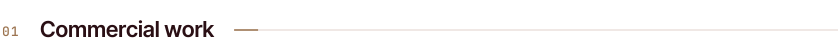
</picture>

<picture>
  <source media="(prefers-color-scheme: dark) and (max-width: 600px)" srcset="assets/work-m-dark.svg">
  <source media="(prefers-color-scheme: light) and (max-width: 600px)" srcset="assets/work-m-light.svg">
  <source media="(prefers-color-scheme: dark)" srcset="assets/work-dark.svg">
  <source media="(prefers-color-scheme: light)" srcset="assets/work-light.svg">
  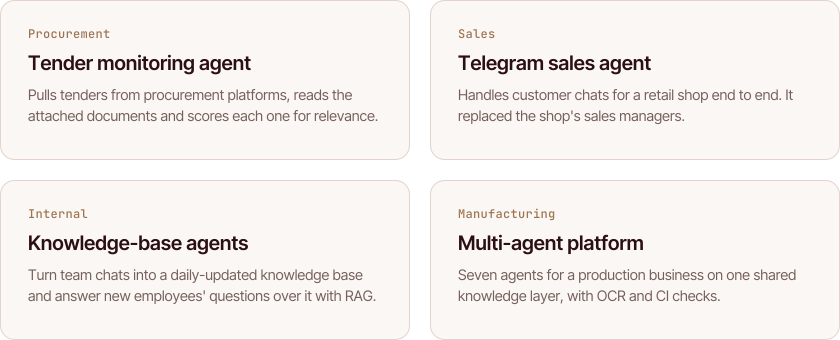
</picture>

Client projects are under NDA, so they are described by task, not by name.

 

<picture>
  <source media="(prefers-color-scheme: dark) and (max-width: 600px)" srcset="assets/divider-hackathons-m-dark.svg">
  <source media="(prefers-color-scheme: light) and (max-width: 600px)" srcset="assets/divider-hackathons-m-light.svg">
  <source media="(prefers-color-scheme: dark)" srcset="assets/divider-hackathons-dark.svg">
  <source media="(prefers-color-scheme: light)" srcset="assets/divider-hackathons-light.svg">
  
</picture>

<picture>
  <source media="(prefers-color-scheme: dark) and (max-width: 600px)" srcset="assets/hackathons-m-dark.svg">
  <source media="(prefers-color-scheme: light) and (max-width: 600px)" srcset="assets/hackathons-m-light.svg">
  <source media="(prefers-color-scheme: dark)" srcset="assets/hackathons-dark.svg">
  <source media="(prefers-color-scheme: light)" srcset="assets/hackathons-light.svg">
  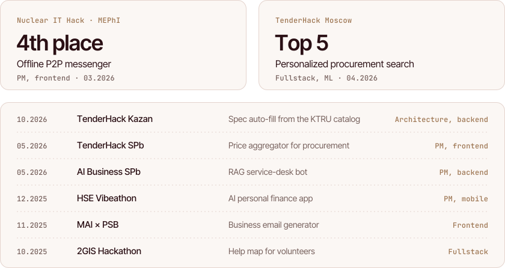
</picture>

 

<picture>
  <source media="(prefers-color-scheme: dark) and (max-width: 600px)" srcset="assets/divider-projects-m-dark.svg">
  <source media="(prefers-color-scheme: light) and (max-width: 600px)" srcset="assets/divider-projects-m-light.svg">
  <source media="(prefers-color-scheme: dark)" srcset="assets/divider-projects-dark.svg">
  <source media="(prefers-color-scheme: light)" srcset="assets/divider-projects-light.svg">
  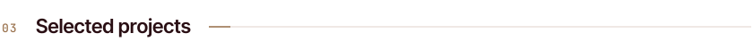
</picture>

<a href="https://github.com/Deci1337/TenderHackMoscow"><picture>
  <source media="(prefers-color-scheme: dark) and (max-width: 600px)" srcset="assets/card-tenderhack-moscow-m-dark.svg">
  <source media="(prefers-color-scheme: light) and (max-width: 600px)" srcset="assets/card-tenderhack-moscow-m-light.svg">
  <source media="(prefers-color-scheme: dark)" srcset="assets/card-tenderhack-moscow-dark.svg">
  <source media="(prefers-color-scheme: light)" srcset="assets/card-tenderhack-moscow-light.svg">
  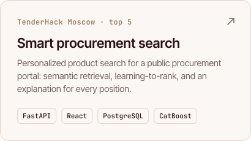
</picture></a>
<a href="https://github.com/Deci1337/MEPhI-HACK"><picture>
  <source media="(prefers-color-scheme: dark) and (max-width: 600px)" srcset="assets/card-mephi-hack-m-dark.svg">
  <source media="(prefers-color-scheme: light) and (max-width: 600px)" srcset="assets/card-mephi-hack-m-light.svg">
  <source media="(prefers-color-scheme: dark)" srcset="assets/card-mephi-hack-dark.svg">
  <source media="(prefers-color-scheme: light)" srcset="assets/card-mephi-hack-light.svg">
  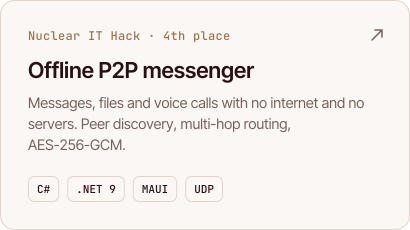
</picture></a>

<a href="https://github.com/Deci1337/TenderHack-SPB"><picture>
  <source media="(prefers-color-scheme: dark) and (max-width: 600px)" srcset="assets/card-tenderhack-spb-m-dark.svg">
  <source media="(prefers-color-scheme: light) and (max-width: 600px)" srcset="assets/card-tenderhack-spb-m-light.svg">
  <source media="(prefers-color-scheme: dark)" srcset="assets/card-tenderhack-spb-dark.svg">
  <source media="(prefers-color-scheme: light)" srcset="assets/card-tenderhack-spb-light.svg">
  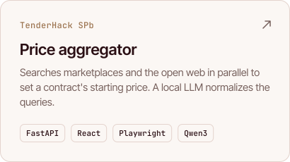
</picture></a>
<a href="https://github.com/Deci1337/AI-business-SaintPetersburg-Case4"><picture>
  <source media="(prefers-color-scheme: dark) and (max-width: 600px)" srcset="assets/card-service-desk-m-dark.svg">
  <source media="(prefers-color-scheme: light) and (max-width: 600px)" srcset="assets/card-service-desk-m-light.svg">
  <source media="(prefers-color-scheme: dark)" srcset="assets/card-service-desk-dark.svg">
  <source media="(prefers-color-scheme: light)" srcset="assets/card-service-desk-light.svg">
  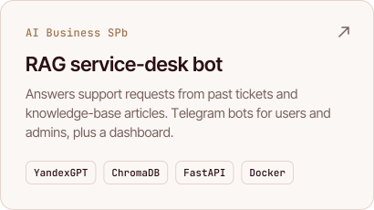
</picture></a>

<a href="https://github.com/Deci1337/AI-finance-assistant"><picture>
  <source media="(prefers-color-scheme: dark) and (max-width: 600px)" srcset="assets/card-finance-assistant-m-dark.svg">
  <source media="(prefers-color-scheme: light) and (max-width: 600px)" srcset="assets/card-finance-assistant-m-light.svg">
  <source media="(prefers-color-scheme: dark)" srcset="assets/card-finance-assistant-dark.svg">
  <source media="(prefers-color-scheme: light)" srcset="assets/card-finance-assistant-light.svg">
  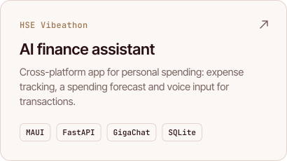
</picture></a>
<a href="https://github.com/Deci1337/TG-parser-clients"><picture>
  <source media="(prefers-color-scheme: dark) and (max-width: 600px)" srcset="assets/card-tg-lead-parser-m-dark.svg">
  <source media="(prefers-color-scheme: light) and (max-width: 600px)" srcset="assets/card-tg-lead-parser-m-light.svg">
  <source media="(prefers-color-scheme: dark)" srcset="assets/card-tg-lead-parser-dark.svg">
  <source media="(prefers-color-scheme: light)" srcset="assets/card-tg-lead-parser-light.svg">
  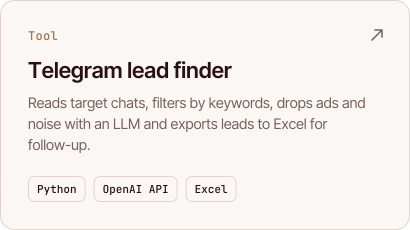
</picture></a>

Video demos: <a href="https://t.me/unrealveliky/84">offline messenger</a> · <a href="https://t.me/unrealveliky/90">procurement search</a> · <a href="https://t.me/unrealveliky/62">finance assistant</a> · <a href="https://t.me/unrealveliky/61">business email assistant</a>

 

<picture>
  <source media="(prefers-color-scheme: dark) and (max-width: 600px)" srcset="assets/divider-stack-m-dark.svg">
  <source media="(prefers-color-scheme: light) and (max-width: 600px)" srcset="assets/divider-stack-m-light.svg">
  <source media="(prefers-color-scheme: dark)" srcset="assets/divider-stack-dark.svg">
  <source media="(prefers-color-scheme: light)" srcset="assets/divider-stack-light.svg">
  
</picture>

<picture>
  <source media="(prefers-color-scheme: dark) and (max-width: 600px)" srcset="assets/stack-m-dark.svg">
  <source media="(prefers-color-scheme: light) and (max-width: 600px)" srcset="assets/stack-m-light.svg">
  <source media="(prefers-color-scheme: dark)" srcset="assets/stack-dark.svg">
  <source media="(prefers-color-scheme: light)" srcset="assets/stack-light.svg">
  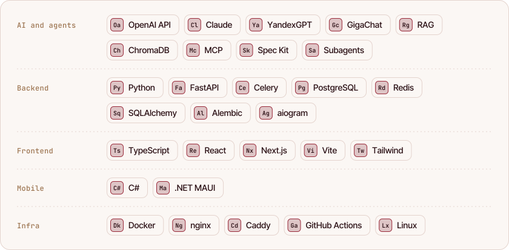
</picture>

 

<picture>
  <source media="(prefers-color-scheme: dark) and (max-width: 600px)" srcset="assets/divider-activity-m-dark.svg">
  <source media="(prefers-color-scheme: light) and (max-width: 600px)" srcset="assets/divider-activity-m-light.svg">
  <source media="(prefers-color-scheme: dark)" srcset="assets/divider-activity-dark.svg">
  <source media="(prefers-color-scheme: light)" srcset="assets/divider-activity-light.svg">
  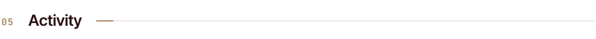
</picture>

<picture>
  <source media="(prefers-color-scheme: dark) and (max-width: 600px)" srcset="assets/activity-m-dark.svg">
  <source media="(prefers-color-scheme: light) and (max-width: 600px)" srcset="assets/activity-m-light.svg">
  <source media="(prefers-color-scheme: dark)" srcset="assets/activity-dark.svg">
  <source media="(prefers-color-scheme: light)" srcset="assets/activity-light.svg">
  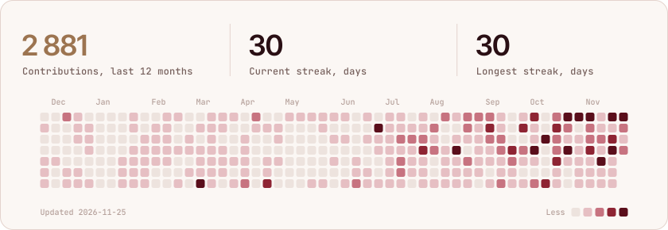
</picture>

 

<a href="https://t.me/Deci1337"><picture>
  <source media="(prefers-color-scheme: dark) and (max-width: 600px)" srcset="assets/footer-m-dark.svg">
  <source media="(prefers-color-scheme: light) and (max-width: 600px)" srcset="assets/footer-m-light.svg">
  <source media="(prefers-color-scheme: dark)" srcset="assets/footer-dark.svg">
  <source media="(prefers-color-scheme: light)" srcset="assets/footer-light.svg">
  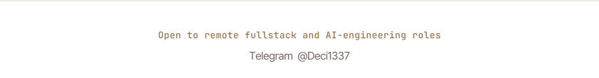
</picture></a>

